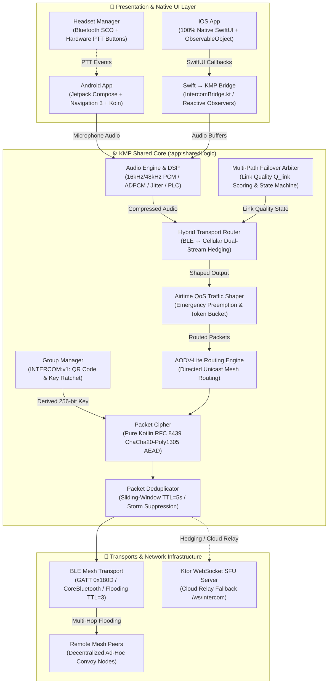
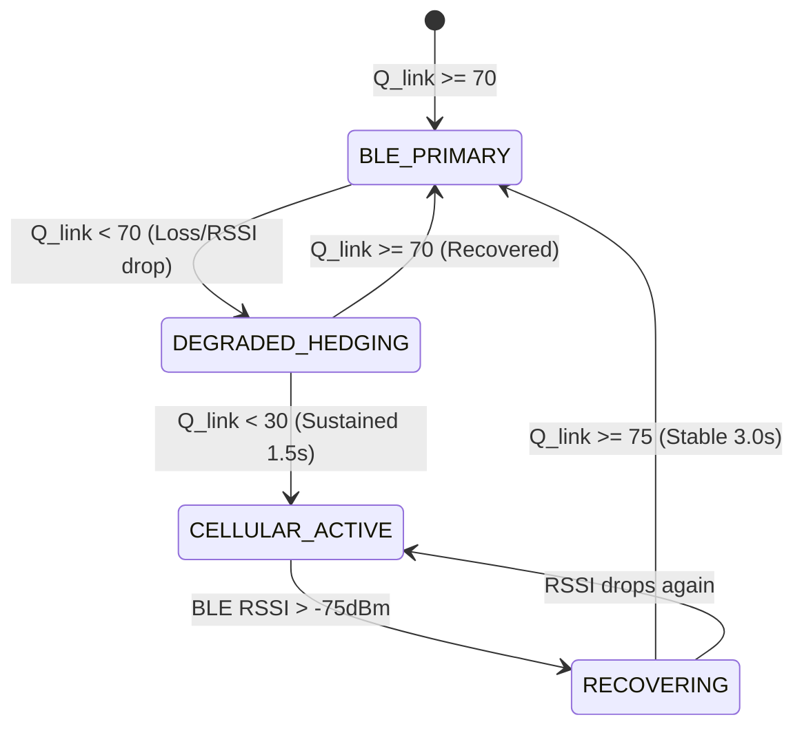

# System Architecture Document — Intercom-Alpha

> **Document Version:** 2.12  
> **Status:** Production Release Tagged (`v2.12.0`) / Sprint 26 Active  
> **Last Updated:** 2026-10-10  
> **Interactive Diagram:** [`docs/architecture/intercom-alpha-architecture.html`](file:///d:/Codes/Antigravity/Project4/Intercom-Alpha/docs/architecture/intercom-alpha-architecture.html)  
> **Related Documents:** [`docs/BRD.md`](./BRD.md) • [`docs/PRD.md`](./PRD.md) • [`docs/TRD.md`](./TRD.md) • [`docs/TASKS.md`](./TASKS.md)

---

## 🏛️ 1. High-Level System Architecture

**Intercom-Alpha** is built as a Kotlin Multiplatform (KMP) monorepo delivering high-performance, decentralized voice communication across Android and iOS devices, with autonomous cellular SFU cloud fallback.

---

## ⚖️ 2. Architectural Decision Records (ADRs)

| ADR ID | Decision Title | Status | Impact / Core Rationale |
| :--- | :--- | :--- | :--- |
| **ADR-001** | BLE Mesh as Primary Transport | Accepted | Guarantees 100% offline operation without internet or cellular connectivity. |
| **ADR-002** | Opus Audio Codec for Mesh Voice | Accepted | Delivers optimal voice intelligibility at ultra-low bitrates (16–32 kbps). |
| **ADR-003** | Decentralized Leaderless Mesh Topology | Accepted | Eliminates single points of failure; group survives leader disconnection. |
| **ADR-004** | KMP Shared Logic + 100% Native SwiftUI | Accepted | **Strict Rule: No Shared UI on iOS**. Android uses Compose; iOS uses native SwiftUI. |
| **ADR-005** | Dual PTT and VOX Transmission Modes | Accepted | Hands-on PTT for high-speed wind; hands-free VOX for technical downhill tracks. |
| **ADR-006** | Foreground Service & Background Audio | Accepted | Enables continuous voice communication with phone locked in pocket/tank bag. |
| **ADR-007** | Offline QR Code Group Onboarding | Accepted | Zero internet exchange: group credentials encoded in `INTERCOM:v1:` QR codes. |
| **ADR-008** | RFC 8439 ChaCha20-Poly1305 AEAD | Accepted | High-speed, authenticated encryption running in pure Kotlin across all targets. |
| **ADR-009** | Retention of `:core` and `:server` | Accepted | Cloud signaling & SFU relay fallback for remote / mixed-mesh connectivity. |
| **ADR-010** | Pure KMP Audio Codec & MTU Optimization | Accepted | 4-bit IMA ADPCM fitting compressed audio frames into single BLE MTU payloads. |
| **ADR-011** | Adaptive Jitter Buffering & PLC | Accepted | RFC 3550 variance delay filter (40–150ms) + pitch-extrapolated packet loss concealment. |
| **ADR-012** | Mesh Airtime QoS Priority Traffic Shaping | Accepted | Token-bucket rate limiting and strict preemption (Emergency > Voice > Telemetry). |
| **ADR-013** | Automated Multi-Path Mesh Failover & Hedging | Accepted | Link quality arbiter scoring RSSI/loss/jitter with proactive BLE/Cellular stream hedging. |

---

## 🛡️ 3. Critical Platform Isolation Decisions

### 3.1 Strict Platform Rule: No Shared UI on iOS (ADR-004)
- **Directive**: Compose Multiplatform is **NOT** used for the iOS target.
- **Implementation**: The iOS client resides entirely in `app/iosApp` as a modern, 100% native SwiftUI project (`ContentView.swift`).
- **Bridge Architecture**: The Swift UI layer communicates with shared KMP logic exclusively via `IntercomBridge.kt` (`app/sharedLogic/src/iosMain`), which provides non-blocking, memory-safe callback observers (`CancellationHandle`).

### 3.2 Dependency Injection & Navigation (Android & SharedUI)
- **Dependency Injection**: Koin 4.0.2 (`koin-core`, `koin-android`, `koin-compose`).
- **Navigation (Android/Desktop)**: Jetpack Navigation Compose with `@Serializable` type-safe routes (`AppNavGraph.kt`).
- **Navigation (iOS)**: Native SwiftUI `NavigationStack` preserving complete UI isolation.

---

## 🔀 4. Multi-Path Failover & Stream Hedging

* **Zero-Drop Playout**: Stream hedging duplicates critical audio frames during transient RF degradation boundaries. Receiving nodes run identical packet deduplication logic, playing the earliest frame and dropping redundant arrivals with zero audio artifacts.
