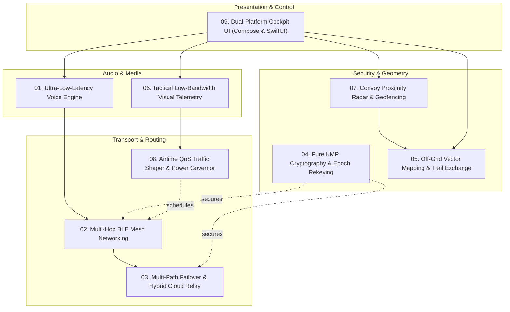

# Feature Specification Landscape — Intercom-Alpha

> **Project:** Intercom-Alpha (Off-Grid BLE Mesh Multiplatform Intercom)  
> **System Status:** Production Baseline Released (`v2.12.0`) / Active Sprint 26 (`sprint/sprint-26-fleet-hardening`)  
> **Authority & Architecture:** Non-Negotiable Architectural Laws (`AGENTS.md`, `docs/ARCHITECTURE.md`, `docs/RULES.md`)  
> **Last Synchronized:** 2026-10-10  

---

## 🗺️ 1. Executive Feature Topology & System Pillars

Intercom-Alpha transforms consumer smartphones into decentralized, off-grid convoy tactical communicators. The system operates across 9 core engineering feature domains:



---

## 📊 2. Master Feature Capability Matrix

| Feature ID | Domain | Feature Name | Capability Summary | Complexity | Status |
|---|---|---|---|---|---|
| **FEAT-01** | Voice DSP | **Ultra-Low-Latency Voice Engine** | Opus 16 kHz VOIP encoding, dynamic VAD, dual-threshold wind noise gate (-35/-42 dBFS), RFC 3550 adaptive jitter buffer (40–150ms), pitch-extrapolated PLC, and BT SCO headset routing. | High | **v2.12.0 Released** |
| **FEAT-02** | Mesh Transport | **Multi-Hop BLE Mesh Networking** | Decentralized GATT peripheral/central mesh, leaderless flood relay ($TTL=3$), AODV-Lite directed routing (RREQ/RREP/RERR), cycle deduplication (`PacketDeduplicator`), and multi-node discovery. | Critical | **v2.12.0 Released** |
| **FEAT-03** | Failover | **Multi-Path Failover & Cloud SFU Relay** | Continuous composite link scoring ($Q_{link}$), proactive dual-stream packet hedging across BLE and Ktor WebSocket relay, zero audio drop during highway convoy separations. | Critical | **v2.12.0 Released** |
| **FEAT-04** | Security | **Pure Multiplatform Cryptography & Rekeying** | Pure KMP RFC 8439 ChaCha20-Poly1305 (zero Java/C dependencies), offline QR-code key distribution (`INTERCOM:v1:`), forward-secret epoch rekeying, dual-epoch transition buffer. | High | **Sprint 26 (ICA-2603)** |
| **FEAT-05** | Mapping | **Off-Grid Vector Mapping & Trail Exchange** | Pure KMP GPX/GeoJSON parser & exporter, MTU-bounded chunking ($\le 100$ bytes), RFC 1950 Adler-32 integrity validation, selective NACK recovery, and offline vector map rendering. | Medium | **v2.12.0 Released** |
| **FEAT-06** | Telemetry | **Tactical Low-Bandwidth Visual Telemetry** | Progressive 0.5 fps compressed snapshot transmission ($\le 1.5$ KB payload), MTU segments ($\le 128$ bytes), dual Adler-32 validation, out-of-order reassembly buffer, selective NACK recovery. | High | **Sprint 26 (ICA-2601)** |
| **FEAT-07** | Safety | **Convoy Proximity Radar & Collision Warning** | Real-time relative ranging via Kalman-filtered BLE RSSI, dynamic geofence drift monitoring, multi-tier threat alerts, crash detection sensor fusion, and emergency alarm flooding. | High | **v2.12.0 Released** |
| **FEAT-08** | QoS / Energy | **Airtime QoS Shaper & Power Governor** | 4-tier strict priority queue (`EMERGENCY_CRITICAL` preempts all), Weighted Fair Queuing (60/40), RF duty-cycle regulation ($\le 10\%$), screen-off audio continuity, Android Partial WakeLock. | High | **v2.12.0 Released** |
| **FEAT-09** | Presentation | **Dual-Platform Cockpit UI** | Android Jetpack Compose + Navigation 3, 100% Native iOS SwiftUI via `IntercomBridge.kt` lifecycle cancellation handles (Rule 1), tactile PTT controls, and avionics HUD telemetry. | High | **v2.12.0 Released** |

---

## 🔍 3. In-Depth Feature Domain Specifications

### 3.1 Feature Domain 01: Ultra-Low-Latency Voice Engine (`FEAT-01`)
* **Primary Target Classes:** `AudioEngine.kt`, `OpusCodec.kt`, `VoiceActivityDetector.kt`, `AdaptiveJitterBuffer.kt`, `PacketLossConcealer.kt`, `HeadsetManager.kt`
* **Architecture & Mechanics:**
  - **Audio Profile:** 16,000 Hz sampling rate, 16-bit PCM mono, 20 ms frame duration (320 samples per frame).
  - **Voice Activity Detection (VAD):** Dynamic RMS energy estimation with hysteresis. Attack threshold opens at -35 dBFS (5 ms attack); release threshold closes at -42 dBFS (100 ms release, 150 ms hold time) to prevent clipping speech tail ends.
  - **Adaptive Jitter Buffer:** Implements RFC 3550 jitter calculation. Dynamically expands from 40 ms up to 150 ms under high packet delay variation, contracting during steady RF conditions to minimize mouth-to-ear latency.
  - **Packet Loss Concealment (PLC):** In the event of lost packets over lossy BLE multi-hop channels, synthesizes missing speech frames using pitch-period waveform extrapolation with gradual attenuation (0.8x decay per frame, max 3 concealed frames) to prevent jarring robotic dropouts.
  - **Hardware Bluetooth SCO Routing:** Binds to standard motorcycle helmet headsets (Sena, Cardo, FreedConn) via platform-native Hands-Free Profile (HFP) Bluetooth Synchronous Connection Oriented (SCO) audio channels.

### 3.2 Feature Domain 02: Multi-Hop BLE Mesh Networking (`FEAT-02`)
* **Primary Target Classes:** `MeshTransport.kt`, `MeshRepeaterService.kt`, `PacketDeduplicator.kt`, `AodvRoutingEngine.kt`, `ConvoyMeshSimulationHarness.kt`
* **Architecture & Mechanics:**
  - **Topology:** Peer-to-peer GATT server/client mesh operating simultaneously in peripheral (advertising) and central (scanning) roles without designated master nodes.
  - **Relay Protocol:** Leaderless controlled broadcast flooding with Hop Count decrementation ($TTL=3$), permitting 4-hop relay coverage extending up to ~1.2 km in line-of-sight convoy formations.
  - **Cyclic Flood Suppression:** Every received packet is checked against `PacketDeduplicator.shouldProcess(packet)` holding a time-bounded LRU cache of sequence numbers and sender IDs, guaranteeing broadcast storm immunity.
  - **AODV-Lite On-Demand Unicast Routing:** When unicasting or conserving medium airtime, dispatches Route Request (RREQ), receives Route Reply (RREP), and maintains dynamic route cache with 30-second soft-state lifetimes.

### 3.3 Feature Domain 03: Multi-Path Failover & Hybrid Cloud/SFU Relay (`FEAT-03`)
* **Primary Target Classes:** `MultiPathFailoverArbiter.kt`, `HybridTransportRouter.kt`, `CloudRelayBridge.kt`
* **Architecture & Mechanics:**
  - **Composite Link Quality Metric ($Q_{link}$):**
    $$Q_{link} = 0.50 \cdot S_{rssi} + 0.35 \cdot S_{loss} + 0.15 \cdot S_{jitter}$$
    where $S_{rssi}$, $S_{loss}$, and $S_{jitter}$ are normalized scores in $[0, 100]$.
  - **4-Stage Automated State Machine:**
    1. `BLE_PRIMARY` ($Q_{link} \ge 70$): Direct BLE mesh communication only; cloud relay disabled.
    2. `DEGRADED_HEDGING` ($30 \le Q_{link} < 70$): Dual-stream hedging active. Outbound packets are duplicated and sent simultaneously over BLE and Ktor WebSocket relay. Receiver deduplication plays the first arrival, yielding 0% dropped audio frames during highway convoy separation.
    3. `CELLULAR_ACTIVE` ($Q_{link} < 30$): Cloud WebSocket relay active as primary transport; BLE transmission throttled.
    4. `RECOVERING`: 5,000 ms hysteresis hold period preventing rapid mode oscillation / flapping at RF range boundaries.

### 3.4 Feature Domain 04: Pure Multiplatform Cryptography & Group Rekeying (`FEAT-04`)
* **Primary Target Classes:** `PacketCipher.kt`, `GroupRekeyProtocol.kt`, `RekeyModels.kt`
* **Architecture & Mechanics:**
  - **Pure KMP Cryptography (Rule 3):** RFC 8439 ChaCha20-Poly1305 implemented with zero Java (`java.security.*`) or native C/JNI dependencies. Poly1305 utilizes Dan Bernstein's 26-bit limb representation over 64-bit Longs, avoiding `BigInteger` allocations in high-frequency audio paths.
  - **Zero-Setup Offline Onboarding:** Convoy pairing occurs via camera scan of an offline `INTERCOM:v1:` QR code containing group credentials and 256-bit group master keys.
  - **Fleet-Wide Over-The-Air Rekeying:** Periodic epoch updates derived via HKDF-SHA256. Maintains a dual-epoch key buffer (`CurrentEpoch`, `PreviousEpoch`) with a 10-second transition grace period to eliminate packet drops during group rekey rotation.

### 3.5 Feature Domain 05: Off-Grid Vector Mapping & Trail Exchange (`FEAT-05`)
* **Primary Target Classes:** `MeshFileTransferEngine.kt`, `MeshFileTransferManager.kt`, `TrailMapEngine.kt`, `VectorMapModels.kt`
* **Architecture & Mechanics:**
  - **Pure KMP Format Support:** Native XML parser/exporter for GPX 1.1 tracks/waypoints and RFC 7946 GeoJSON FeatureCollections with zero external XML libraries.
  - **Segmented MTU Chunking:** Splits trail files into $\le 100$-byte segments fitting cleanly into single BLE GATT MTU notifications.
  - **Integrity & Recovery:** Computes RFC 1950 Adler-32 checksums (modulo 65521). `ReassemblyBuffer` handles out-of-order chunk arrivals and generates selective NACK reports for missing chunk retransmission.

### 3.6 Feature Domain 06: Tactical Low-Bandwidth Visual Telemetry (`FEAT-06`)
* **Primary Target Classes:** `SnapshotModels.kt`, `TacticalSnapshotProtocol.kt`, `SnapshotTransferManager.kt`
* **Architecture & Mechanics:**
  - **Visual Telemetry Specifications:** Transmits compressed 0.5 fps thumbnail snapshots ($\le 1.5$ KB payload, 160x120 resolution) for convoy situational awareness (trail blockages, hazards, rider status).
  - **Non-Fragmenting Mesh Segmentation:** Chunks payload into $\le 128$-byte segments with per-chunk and whole-frame Adler-32 verification.
  - **Selective NACK Retransmission:** Receiver sends intermediate acknowledgments indicating specific missing chunk indices. Sender retransmits only missing chunks with QoS airtime pacing.
  - **RF Duty Cycle Protection:** Rate-limited to 0.5 fps (minimum 2,000 ms frame interval), preventing visual traffic from impacting real-time voice latency.

### 3.7 Feature Domain 07: Convoy Proximity Radar & Collision Warning (`FEAT-07`)
* **Primary Target Classes:** `ProximityRadar.kt`, `ConvoyGeofenceModels.kt`, `CrashDetector.kt`
* **Architecture & Mechanics:**
  - **Relative Distance Ranging:** Smoothes raw BLE RSSI telemetry using a 1D Kalman filter to reject multi-path fading. Maps filtered RSSI to proximity tiers: `IMMEDIATE` ($<5$ m), `CLOSE` ($5–15$ m), `NORMAL` ($15–50$ m), `DISTANT` ($>50$ m).
  - **Dynamic Convoy Geofence:** Emits `GEOFENCE_ALARM` packets when any rider drifts beyond user-configured distance thresholds (e.g. $>200$ m).
  - **Sensor Fusion Crash Detection:** Combines smartphone accelerometer/gyroscope impulse detection with sudden loss of RF heartbeat. Floods emergency SOS packets across the mesh with top QoS priority.

### 3.8 Feature Domain 08: Airtime QoS Traffic Shaper & Power Governor (`FEAT-08`)
* **Primary Target Classes:** `MeshQoSScheduler.kt`, `QoSModels.kt`, `PowerGovernor.kt`, `PowerManagerHelper.kt`
* **Architecture & Mechanics:**
  - **4-Tier Priority Queuing:**
    1. `EMERGENCY_CRITICAL`: SOS, crash alarms, geofence breaches (immediately preempts all queues).
    2. `ACTIVE_VOICE`: Real-time Opus audio packets and cross-mesh federation audio.
    3. `ROUTING_CONTROL`: AODV RREQ/RREP, join/leave, ping/pong, heartbeat beacons.
    4. `BULK_TELEMETRY`: GPX trail chunks, tactical snapshot chunks, power status reports.
  - **Contention Pacing:** Enforces $\le 10\%$ RF duty cycle for bulk telemetry during active voice or heavy airtime.
  - **Battery Conservation:** Android Partial WakeLock with safety timeouts, iOS background audio and CoreBluetooth background modes, adaptive scan duty cycling based on convoy motion.

### 3.9 Feature Domain 09: Dual-Platform Cockpit UI (`FEAT-09`)
* **Primary Target Classes:**
  - Android: `MainActivity.kt`, `HomeScreen.kt`, `AppNavGraph.kt`, `AppModule.kt`
  - iOS: `ContentView.swift`, `IntercomViewModel.swift`, `IntercomBridge.kt`
* **Architecture & Mechanics:**
  - **Strict Platform Isolation (Rule 1):** Zero Compose Multiplatform on iOS. iOS client in `app/iosApp` is 100% native SwiftUI.
  - **Reactive Bridge Lifecycle:** All iOS interactions route through `IntercomBridge.kt` (`iosMain`) with typed callback closures returning `CancellationHandle` objects canceled on view `.onDisappear`.
  - **Tactile PTT & HUD Display:** Oversized motorcycle-glove-friendly Push-to-Talk button, real-time audio VU meter, tactical transport badge (`BLE` / `HEDGED` / `CLOUD` / `OFFLINE`), convoy radar distance tape, and offline vector map.

---

## 🔗 4. Feature Dependencies & Execution Graph

```
[FEAT-04: Crypto & Rekeying] ──enables──► [FEAT-02: BLE Mesh Networking]
                                                   │
               ┌───────────────────────────────────┼──────────────────────────────────┐
               ▼                                   ▼                                  ▼
[FEAT-01: Voice DSP Engine]        [FEAT-03: Multi-Path Failover]     [FEAT-08: Airtime QoS Shaper]
               │                                   │                                  │
               │                                   ▼                                  │
               │                     [Cloud SFU Ktor Relay]                           │
               │                                                                      │
               ├───────────────────────────────────┬──────────────────────────────────┤
               ▼                                   ▼                                  ▼
[FEAT-05: Trail Vector Mapping]    [FEAT-06: Tactical Visual Snapshots] [FEAT-07: Proximity Radar]
               │                                   │                                  │
               └───────────────────────────────────┼──────────────────────────────────┘
                                                   ▼
                                  [FEAT-09: Dual-Platform Cockpit UI]
```

---

## 🚫 5. Anti-Features (Explicitly Rejected Technical Concepts)

| Anti-Feature | Why Requested | Why Rejected | Established Architectural Pattern |
|---|---|---|---|
| **Compose Multiplatform on iOS** | Code reuse for screens across both platforms. | Violates Rule 1. Severely degrades iOS background audio lifecycle, CoreBluetooth latency, and native SwiftUI ergonomics. | 100% Native SwiftUI on iOS connected via `IntercomBridge.kt`. |
| **Java Cryptography (`java.security.*`) in KMP** | Standard Java libraries readily available in JVM/Android. | Violates Rule 3. Fails to compile on iOS Native and Web targets without heavy C-interop. | Pure Kotlin RFC 8439 ChaCha20-Poly1305 with 26-bit limbs. |
| **Server-Centric Cloud-Only Signaling** | Simpler VoIP architecture using standard WebRTC servers. | Violates Core Product Pillar 1 (zero internet, off-grid operation). Inoperable in mountain valleys. | Decentralized BLE Mesh primary transport with optional cloud relay fallback. |
| **Unbounded Packet Flooding** | Simplest way to ensure all nodes receive data. | Saturated 2.4 GHz RF medium causing collision cascades and voice dropouts. | Controlled flooding with $TTL=3$, `PacketDeduplicator`, and AODV-Lite directed unicast. |
| **Raw Uncompressed Image Streaming** | High-definition live video feeds from motorcycle helmets. | Completely overwhelms BLE GATT throughput ($<100$ kbps) and starves voice channels. | 0.5 fps thumbnail snapshots ($\le 1.5$ KB) with strict QoS airtime duty cycles. |
